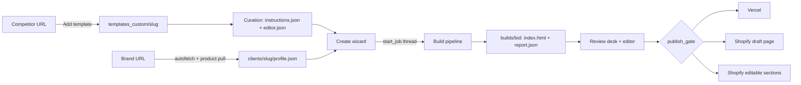

# # LP Tool: How It Works  
  
This document covers the infrastructure and mechanics of the landing-page tool: what runs, where data lives, and how a page moves from a competitor URL to a published funnel. It contains no client or brand data.  
  
It describes the code on branch `feature/template-stripping-generalization` as of 2026-10-06. Functions are named as stable anchors. Search for the name rather than trusting a line number, because the files change often.  
  
## Contents  
  
1. [Summary](#1-summary)  
2. [System map](#2-system-map)  
3. [Runtime and process model](#3-runtime-and-process-model)  
4. [Hosting and deployment](#4-hosting-and-deployment)  
5. [Storage](#5-storage)  
6. [External services and models](#6-external-services-and-models)  
7. [Stage 1: Brand intake](#7-stage-1-brand-intake)  
8. [Stage 2: Template onboarding](#8-stage-2-template-onboarding)  
9. [Stage 3: Create wizard and job kickoff](#9-stage-3-create-wizard-and-job-kickoff)  
10. [Stage 4: The build pipeline](#10-stage-4-the-build-pipeline)  
11. [Stage 5: Review desk and editor](#11-stage-5-review-desk-and-editor)  
12. [Stage 6: Publishing](#12-stage-6-publishing)  
13. [Route reference](#13-route-reference)  
14. [Module index](#14-module-index)  
15. [Developer tooling and tests](#15-developer-tooling-and-tests)  
16. [Scaffolding that is not wired in](#16-scaffolding-that-is-not-wired-in)  
17. [Operational caveats](#17-operational-caveats)  
  
---  
  
## 1. Summary  
  
The LP tool turns a proven competitor landing page into a reusable **template**. It then rebuilds that template for any brand:  
  
- recoloured to the brand palette;  
- rewritten by Claude in the brand's voice;  
- re-imaged with fal.ai, using the brand's real product photos;  
- scrubbed of every trace of the source brand;  
- published to Vercel, to a Shopify draft page, or to Shopify as editable theme sections.  
  
It is a single Python process built on the standard library's `http.server`, with no web framework. JSON files on disk are the primary store and Postgres mirrors them. Slow work runs in in-process background threads that the browser polls.  
  
---  
  
## 2. System map  
  
```  
Browser  
  │   Cloudflare Access (team SSO) in front of lp.adcubator.ai  
  ▼  
Railway service "landing pages"  
  python -m infra.lp.web            (ADC_TOOL=lp)  
  │   stdlib ThreadingHTTPServer  
  │   hand-rolled routing: web.py Handler.do_GET / do_POST  
  │   in-memory job registry + one daemon thread per job  
  │  
  ├── Engine modules        infra/lp/*.py  
  ├── Data dir              Railway volume (/data) = ADC_DATA_DIR  
  ├── Postgres              DATABASE_URL: brands + generations ledger mirror  
  └── Supabase Vault        per-brand Shopify app credentials and tokens  
  
Outbound calls  
  Anthropic Messages API    copy, vision planning, analysis, edit agent  
  fal.ai                    image generation and image edits  
  Vercel REST API           static deploys  
  Shopify Admin GraphQL     pages, theme files, Files CDN, product pulls  
  Playwright / Chromium     rendering, parity checks, bot-wall fallback, QA shots  
  Residential proxy         ADC_FETCH_PROXY, for bot-walled fetches  
```  
  

  
---  
  
## 3. Runtime and process model  
  
### 3.1 One codebase, five tools  
  
Every Adcubator tool is the same `infra/lp/web.py` app, started with a different `ADC_TOOL` value.  
  
| `ADC_TOOL` | Tool | Local port in `start.sh` |  
|---|---|---|  
| `lp` (default) | Landing pages | 8000 |  
| `creatives` | Static ad creatives | 8001 |  
| `media` | Media buying | 8002 |  
| `billing` | Agency billing | 8003 |  
| `content` | Content tooling | 8004 |  
  
The switch changes only the front page, the nav, and some list filters. Every route is still served in every mode. The `/voice` and `/bank` routes are the exception: they exist only in `content` mode.  
  
### 3.2 HTTP server  
  
- `web.main()` starts `ThreadingHTTPServer((HOST, PORT), Handler)`. `HOST` defaults to `0.0.0.0` and `PORT` to `8000`. Use `127.0.0.1` locally on macOS.  
- `Handler.do_GET` and `Handler.do_POST` match the path with `==` and `re.match`, in order.  
- In `do_POST`, a `SystemExit` becomes a 400 JSON error and any other exception a 500 JSON error.  
- Pages are Python f-strings. The shared browser script `JS_BASE` provides toasts, job polling and the `runJob` helper.  
- **There is no authentication in the app.** Cloudflare Access at the edge is the only gate.  
  
### 3.3 Background jobs  
  
`web.start_job(kind, label, fn, dedupe_key)` runs every slow action: builds, image edits, the edit agent, product fidelity, mobile optimisation and template adds.  
  
- It creates a record `{id, kind, label, status, error, result, progress[], started, ended}` in the in-memory `_JOBS` dict.  
- If a running job has the same dedupe key, that job is returned instead. This prevents paying twice for one build.  
- It starts one `threading.Thread(daemon=True)`. There is no queue and no concurrency limit.  
- If `fn` takes the job as its first argument, the engine gets `on_event=job["progress"].append` and can stream progress lines.  
- It catches `BaseException`, because engine code raises `SystemExit` for user-facing errors.  
- When the job ends, `_job_notice` writes a notification and `_bump()` increments the jobs revision counter.  
- The 40 most recent finished jobs are kept.  
- **Jobs live only in memory.** A restart loses every running and finished job.  
  
### 3.4 How progress reaches the browser  
  
There is no Server-Sent Events or WebSocket channel. Everything is polling.  
  
- `JS_BASE.pollJobs` polls `GET /api/jobs` every 1.5 seconds while a job runs. When idle it backs off from 8 to 30 seconds, and it pauses in hidden tabs. It skips re-rendering when the revision counter has not changed.  
- `renderJobs` drives the toast tray and the unread dot on the bell.  
- The editor screens poll `GET /api/jobs/<id>` every 900 ms and show the job's `progress[]` lines live.  
- The wizard's "press run" screen advances on client-side timers. Only the final completion comes from the real job.  
  
### 3.5 Boot sequence  
  
Running `python -m infra.lp.web` does the following at import time, then calls `main()`:  
  
1. **Imports** about 40 modules, including the other tools' engines.  
2. **`env.load()`** reads the repo-root `.env` with `os.environ.setdefault`, so a real environment variable always wins.  
3. **`env.data_dir()`** resolves `ADC_DATA_DIR`. A relative value is anchored to the repo root. Locally `.env` sets `lp`; on Railway it points at the volume.  
4. **`env.seed_data_dir()`** runs whenever the data dir is not the repo root:  
   - copies `clients/`, `builds/`, `content/` and `data/` from the repo if each is missing;  
   - copies `swipefile.json`, `billing.json`, `googleads_cache.json` and `statics_published.json` if missing;  
   - **adopts committed builds:** each repo `builds/<bid>` that has an `index.html`, is not `_`-prefixed, and has no real copy on the volume is copied in. A volume copy is never overwritten.  
5. **`env._sync_custom_templates()`** mirrors the repo's `lp/templates_custom/` and `lp/templates_retired.json` onto the volume. It adds, replaces **and removes** templates, so the repo is the authority.  
6. **Builds folder:** `BUILDS = data_dir()/"builds"` is created.  
7. **Database thread:** if `DATABASE_URL` is set, a daemon thread runs `_boot_migrate`:  
   - runs `db.migrate_from_json()` if the database has no brands;  
   - runs `_adopt_committed_history`, which inserts ledger rows from the repo's `clients/*/history.json` for builds that exist on disk but not in the database;  
   - sets `db.READY = True`. Until then, reads stay on JSON files.  
8. **Notifications** load from `data_dir()/notifications.json`, newest first, capped at 120.  
9. **`main()`** starts serving.  
  
---  
  
## 4. Hosting and deployment  
  
### 4.1 Railway  
  
- **Service:** "landing pages" on Railway, serving `lp.adcubator.ai`. It auto-deploys from the GitHub branch above.  
- **Builder:** Railpack. The repo's `nixpacks.toml` is ignored.  
- **Chromium:** installed through the Railway service variable `RAILPACK_PYTHON_PLAYWRIGHT_INSTALL=1`. That setting lives in Railway, not in the repo, and only the LP service has it.  
- **Dependencies:** `requirements.txt` installs `beautifulsoup4`, `playwright`, `psycopg[binary]` and `Pillow`. Everything else is the standard library. `requirements-v2.txt` is never installed.  
- **Volume:** mounted at `/data` and used as `ADC_DATA_DIR`. A git deploy cannot change volume contents except through the boot seeding and template sync above.  
- **Postgres:** a Railway Postgres service. `db.connect()` opens with autocommit off, so every write needs an explicit commit.  
- **Edge:** Cloudflare Access. An unauthenticated request gets a 302.  
  
Useful commands:  
  
```bash  
railway logs --lines 200                    # logs stream forever without --lines  
railway ssh -- python3 - < script.py        # run a script inside the container  
railway ssh -- sh -s < script.sh            # argument quoting is stripped; pipe stdin instead  
```  
  
### 4.2 How things reach the cloud  
  
| What | How it ships |  
|---|---|  
| Code | `git push` to the branch. Railway rebuilds and redeploys. |  
| Custom templates | Add the template locally, commit `lp/templates_custom/<slug>/` and `lp/templates_retired.json`, push. The boot sync mirrors them onto the volume. Templates added through the cloud UI are deleted on the next deploy. |  
| A locally built funnel | Copy it to the repo-root `builds/<bid>/`, commit it with the matching repo-root `clients/<slug>/history.json`, and push. Boot adoption copies the build and inserts its ledger rows. |  
  
The cloud Library lists builds from the Postgres ledger, not from the filesystem. A build folder with no ledger row is invisible.  
  
`.gitignore` keeps the local data dir `lp/` out of git except `lp/templates_custom/` and `lp/templates_retired.json`. `_`-prefixed builds are scratch and never committed.  
  
### 4.3 Running locally  
  
```bash  
cd adcubator  
ADC_TOOL=lp PORT=8000 ADC_DATA_DIR=lp .venv/bin/python -m infra.lp.web  
```  
  
- Use `.venv/bin/python`. The system `python3` has no `bs4` or `pytest`.  
- Don't `source .env`. The app loads it itself, and zsh fails on the `${…}` inside `DATABASE_URL`.  
- `bash start.sh` runs all five tools on ports 8000 to 8004. It calls plain `python3`, so it only works if that resolves to an environment with the dependencies.  
  
### 4.4 Environment variables  
  
| Variable | Read by | Purpose |  
|---|---|---|  
| `ANTHROPIC_API_KEY` | every Claude call | Required (`env.require`). |  
| `FAL_KEY` | `infra/statics/fal.py` | Required for image generation and edits. |  
| `VERCEL_TOKEN` | `deploy.py` | Required for Vercel deploys. |  
| `SUPABASE_URL`, `SUPABASE_SERVICE_KEY` | `secrets.py` | Shopify credential vault. No fallback. |  
| `DATABASE_URL` | `db.py`, `web.py` | Turns on Postgres and the boot migration. Blank it for tests. |  
| `DB_PATH` | `db.py` | SQLite path when there is no `DATABASE_URL`. |  
| `ADC_DATA_DIR` | `env.py` | Runtime data root. Default is the repo root. |  
| `ADC_TOOL` | `web.py` | Which tool this process serves. |  
| `ADC_FETCH_PROXY` | `botwall.py` | Residential proxy URL for bot-walled fetches. Credentials stay in Railway variables only. |  
| `ADC_MOCK_IMAGES` | `fal.py` | `1` returns free placeholder images. Set only by `scripts/test_build.py --mock-images`. |  
| `PORT`, `HOST` | `web.py` | Listen address. |  
| `ELEVENLABS_API_KEY`, `ATRIA_API_KEY`, `GOOGLE_ADS_*` | other tools | Not used by the LP pipeline. |  
| `ADC_API_KEY` | `apiserver.py` | Only for the unused FastAPI scaffold. |  
  
`.env.example` is out of date. It still lists per-store Shopify admin tokens, which nothing reads, and it lacks the Supabase and `ADC_*` variables.  
  
---  
  
## 5. Storage  
  
### 5.1 Data directory layout  
  
```  
<ADC_DATA_DIR>/  
├── clients/<slug>/  
│   ├── profile.json              Brand DNA + products[]  
│   ├── history.json              ledger rows, newest first  
│   ├── angles/<handle>.json      cached angle library  
│   ├── briefing/<handle>.json    cached wizard briefing  
│   └── comparison/<handle>.json  cached comparison table (comparison seed)  
├── builds/  
│   ├── <bid>/  
│   │   ├── index.html            the page; images are inlined as data URIs  
│   │   ├── report.json           build report, status, costs, warnings  
│   │   ├── copy.review.json      text fragments for the review desk  
│   │   ├── images.versions.json  per-slot image history (max 5 per slot)  
│   │   ├── history/              page snapshots + snapshots.json (max 12)  
│   │   ├── chat.json             edit-agent conversation  
│   │   └── qa-desktop.png, qa-mobile.png, og.png   (only after QA runs)  
│   ├── _tpladd-<slug>/           scratch clones from Add Template  
│   └── .trash/<bid>/             soft-deleted builds, swept after 7 days  
├── templates_custom/<slug>/      custom templates (see section 8.3)  
├── templates_retired.json        built-in seeds hidden from the picker  
└── notifications.json            job-finished notices  
```  
  
The built-in seeds live in the repo, not in the data dir: `templates/seeds/<type>/index.html`, with preview mockups in `templates/_originals/`.  
  
There is no `images/` folder in a build. Every image is a data URI inside `index.html`, so a page is often 2 MB or more.  
  
### 5.2 Files, Postgres and Vault  
  
- **Files are primary.** `clients.py` always writes the JSON file. It also writes to the database once `db.READY` is set, and reads from the database when ready.  
- **Postgres or SQLite** (`infra/db.py`) has two tables, `brands` and `generations`. SQLite is the default; `DATABASE_URL` switches to Postgres through psycopg.  
- **Supabase Vault** holds Shopify secrets. Table `public.brand_secrets` stores the shop domain, client id, the token's last 4 characters and a `vault_secret_id`. The vault secret itself holds `{client_secret, token}`. Access goes through `security definer` RPCs: `brand_secret_save`, `brand_secret_get`, `brand_secret_status` and `brand_secret_delete`. The SQL is not in a migration file; it is only in `docs/superpowers/plans/2026-07-29-shopify-oauth-install.md`.  
  
### 5.3 Build IDs  
  
`web.build_id(prefix, client)` mints `<client>-<slug(prefix)>`, then tries `-2`, `-3` and so on.  
  
- A candidate is skipped if any ledger row already uses it, so a deleted build's id is never reused.  
- The folder is reserved with `mkdir(exist_ok=False)`, which is atomic against concurrent jobs.  
- The prefix is the template slug for custom templates, `<type>-<product>` for seeds, and `top5` for the competitor builder.  
  
### 5.4 Ledger and spend  
  
`generate.record_funnel` calls `clients.append_history`, which writes one ledger row under a lock to `history.json` and, when ready, to the `generations` table.  
  
- Row fields: `ts`, `build_id`, `mode`, `template`, `product`, `status`, `model`, `input_tokens`, `output_tokens`, `cost_usd`, `cost_breakdown`.  
- `status` names the action: the template status for a build, or `redraft`, `agent-edit`, `image-edit`, `image-generate`, `product-fidelity` or `mobile-optimize` for later paid actions. One build therefore has many rows.  
- Rows sharing a `build_id` are passes on one build. The Library shows one card per id.  
  
Costs come from `spend.py`, a thread-local ledger. Each job calls `spend.reset()`; providers record through `spend.add` and `spend.add_anthropic`; the job reads `spend.total()` and `spend.snapshot()` at the end. The buckets are "Anthropic (copy)", "Anthropic (vision/analysis)" and "fal.ai (images/video)".  
  
These calls are **not** recorded in spend: the angle library, the wizard briefing, the author persona, `localize`, and `fal.remove_bg`.  
  
`billing.json` is unrelated to build spend. It holds Google Ads agency-fee profiles for the billing tool.  
  
---  
  
## 6. External services and models  
  
Every Claude call is a raw `urllib` POST to `https://api.anthropic.com/v1/messages`, with no SDK. Every fal call goes through `infra/statics/fal.py`.  
  
### 6.1 Anthropic  
  
| Use | Module | Model |  
|---|---|---|  
| Copy rewrite | `copywriter.py` | `claude-sonnet-4-6` |  
| Template blueprint analysis | `blueprint.py` | `claude-sonnet-4-6` |  
| Shopify editor map ("architect") | `structure.py` (through blueprint's caller) | `claude-sonnet-4-6` |  
| Image strip plan (vision) | `classify.py` | `claude-sonnet-4-6` |  
| Product fidelity check (vision) | `productfix.py` (through classify's caller) | `claude-sonnet-4-6` |  
| Brand autofetch refinement | `autofetch.py` | `claude-sonnet-4-6` |  
| Product enrichment | `shopify.enrich` (through blueprint's caller) | `claude-sonnet-4-6` |  
| Angle library | `angles.py` | `claude-sonnet-4-6` |  
| Edit agent | `agent.py` | `claude-sonnet-4-6` |  
| Mobile AI fix | `mobile.py` | `claude-sonnet-4-6` |  
| Author persona | `copywriter.author_persona` | `claude-haiku-4-5-20251001` |  
  
Pricing tables live in both `copywriter.py` and `spend.py`.  
  
### 6.2 fal.ai  
  
| Use | Model | Cost per call |  
|---|---|---|  
| Text-to-image: scenes, people, generic bottles | `fal-ai/nano-banana-pro` | $0.15 |  
| Image edits and product compositing (`PRO_EDIT_MODEL`) | `fal-ai/nano-banana-pro/edit` | $0.15 |  
| Cheap edit (not used by LP) | `fal-ai/gemini-25-flash-image/edit` | $0.04 |  
| Background removal (not used by LP) | `fal-ai/birefnet` | $0.01 |  
  
- **Mock mode:** with `ADC_MOCK_IMAGES=1`, generate, edit and background removal return a locally drawn "MOCK IMAGE" JPEG at zero cost.  
- **Account lock:** a "locked" or top-up error is stored in the module-global `LAST_LOCK`. Later calls fail fast until a build calls `fal.clear_lock()` at its start.  
  
### 6.3 Other services  
  
| Service | How it is called |  
|---|---|  
| Vercel | REST API: `/v2/files` uploads, then `/v13/deployments`. Team scope `adcubatorai`. |  
| Shopify | Admin GraphQL API, version `2026-01`, header `X-Shopify-Access-Token`. |  
| Supabase | `POST {SUPABASE_URL}/rest/v1/rpc/<fn>` with the service key. |  
| Playwright Chromium | Brand autofetch styles, bot-wall fallback, Shopify parity simulation, QA screenshots, mobile AI screenshots. |  
  
### 6.4 Fetching pages: the bot-wall ladder  
  
`botwall.py` handles every outbound page fetch for cloning and product pulls. It climbs three steps:  
  
1. A plain `urllib` GET with a Chrome user agent.  
2. On 403 or 429, one retry after `Retry-After`, capped at 8 seconds.  
3. A Playwright Chromium fetch that returns the raw response body.  
  
When `ADC_FETCH_PROXY` is set, both `urllib` and Chromium go through that proxy. Shopify product pulls pass `lang=False`, which drops `Accept-Language`. Without that, Shopify Markets localises prices to the proxy's egress country.  
  
---  
  
## 7. Stage 1: Brand intake  
  
A brand profile is the input to every build. It is created from a URL and then edited by hand.  
  
### 7.1 Brand model  
  
`clients.py` defines two dataclasses.  
  
- **`Brand`:** name, tagline, positioning, audience, brand context, voice, language, primary/dark/tint/accent colours, logo, favicon, CTA text, sale percent, promo text, meta title and description, voice examples, `source_hue`, USP icons, `products[]` and an optional `brand_md` file.  
- **`Product`:** handle, name, URL, price, sale price, description, specs, USPs, images, variants and selling context.  
  
`Brand.for_product(handle)` returns a copy bound to one product. It appends the product's specs, USPs, price and context to `voice`, which is how product facts reach the copywriter.  
  
The profile has no font field. Autofetch detects fonts, but they are not saved.  
  
### 7.2 Autofetch from a brand URL  
  
`autofetch.autofetch(url)` behind `POST /api/clients/autofetch`:  
  
1. **Static fetch:** name from `og:site_name` or `<title>`, tagline from the meta description, logo from `og:image` or the icons.  
2. **Rendered pass:** Playwright reads computed button, header, footer and body colours, saturated brand colours, fonts and `<html lang>`.  
3. **Colour choice:** rendered brand colour, then CTA colour, then `theme-color`, then the dominant hex. Third-party colours such as payment and review widgets are filtered out. Dark and tint shades are derived.  
4. **AI refinement:** one Claude call fills name, tagline, positioning, audience, voice, CTA, brand context, language and primary colour.  
  
The result goes back to the form. Nothing is saved until the operator saves.  
  
### 7.3 Product pull  
  
`POST /api/clients/<slug>/product/pull` runs `_pull_product`:  
  
1. If the brand has a connected store, `shopify.pull_admin` reads the product through Admin GraphQL.  
2. Otherwise `shopify.pull`:  
   - fetches `/products/<handle>.json`, with a fuzzy fallback to `/products.json?limit=250`;  
   - on a bot wall, retries once through Chromium;  
   - falls back to JSON-LD, then Open Graph, then `<h1>`.  
3. Selling plans are read from `/products/<handle>.js` and added as "Pricing" lines.  
4. `shopify.enrich` makes one Claude call that fills description, USPs, specs and context from the page text.  
  
### 7.4 Cached strategy  
  
These are built once per product and cached under the brand folder.  
  
- **Angle library** (`angles.get_or_build`): avatar, primary pain, core desire, moat, mechanism, objections and five angles tagged by awareness level. `pick_angle` chooses one by template type. Only seed builds use it.  
- **Briefing** (`briefing.get_or_build`): four audience options plus benefits, features and objections for the wizard. `briefing.compose` turns the operator's picks into an "OPERATOR TARGETING" block for the copywriter.  
- **Comparison** (`angles.get_or_build_comparison`): axes, winner, competitors and table rows for the comparison seed.  
  
---  
  
## 8. Stage 2: Template onboarding  
  
A template is a stored competitor page plus the metadata that lets the build pipeline strip and rebuild it.  
  
**Key point:** adding a template only clones it and analyses it. The actual stripping of the source brand runs on every build, in `clonebuild.rebrand_into`.  
  
### 8.1 Add a template  
  
`POST /api/templates/add` starts a job that runs `web._add_template`:  
  
1. **Clone:** `clone.clone(url, builds/_tpladd-<slug>)`. Pasted HTML skips the fetch and uses `clone._source_identity`.  
2. **Validate:** `templates.validate_template_html` rejects bot-wall or captcha pages and anything under 5,000 bytes.  
3. **Save:** `templates.save_custom` writes `index.html` and `meta.json`. A slug that collides with a seed gets `-custom`.  
4. **Blueprint:** `blueprint.ensure_for_template` runs the AI analysis and writes `blueprint.json`.  
5. **Editor map:** `structure.ensure_for_template` runs the AI "architect" and writes `editor.json`.  
  
Both analysis files are saved only when the AI call succeeded, so a heuristic fallback is never frozen into the template.  
  
### 8.2 What the clone does  
  
`clone.clone()` is deliberately light:  
  
- **Fingerprint:** detects the platform (Shopify, Replo, Webflow, ClickFunnels, Funnelish, WordPress, Framer). A store page with "add to cart" gets a "REBUILD NATIVE" verdict.  
- **CSS:** each `<link rel=stylesheet>` is fetched into a `<style>` block and its `url()`s are made absolute.  
- **Trackers:** only known tracker scripts are removed (GTM, GA, Facebook pixel, Clarity, Hotjar, Segment, Klaviyo, Heap, FullStory, Mixpanel, Amplitude). Functional JavaScript stays.  
- **Images:** `data-src` becomes `src`, broken `////host` URLs are fixed, URLs are made absolute and `loading` is dropped.  
- **Media:** `<video>` and Lottie become `div.adc-media-slot` placeholders.  
- **Identity:** the source host comes from the URL and the source name from `og:site_name`.  
- **Cleanup:** a `<base href>` is added and nested `<p>` tags are flattened.  
  
### 8.3 Template folder contents  
  
| File | Written by | Purpose |  
|---|---|---|  
| `index.html` | `save_custom`, then hand edits | The stored page. |  
| `meta.json` | `save_custom` | `type`, `name`, `source_host`, `source_name`, `origin`, `origin_url`, `source_hue`. |  
| `blueprint.json` | AI at add time | How to rebrand: palette, brand tokens, logo images, CTA links, variant sections, notes. |  
| `instructions.json` | A developer, by hand | Per-template rules for copy, images and purges (section 8.5). |  
| `editor.json` | AI at add time, then hand edits | Shopify editor section and role map (section 8.6). |  
  
### 8.4 `blueprint.json`  
  
`blueprint.analyze` starts from a heuristic and refines it with one Claude call:  
  
- **Heuristic:** the palette from saturated hue families, logo images whose src, class, id or alt contains "logo", and absolute links.  
- **AI pass:** sees a digest of the page (top colours, images, links, headings and 4,000 characters of text) and returns `palette`, `brand_tokens`, `logo_srcs`, `cta_hrefs`, `variant_sections` and `notes`.  
  
At build time:  
  
- the palette drives an exact-hex recolour, then a hue-family sweep;  
- `logo_srcs` are swapped for the brand's logo;  
- `brand_tokens` feed the source-brand scrubbers.  
  
`identity_tokens` keeps only short tokens, so a long claim phrase is never replaced with the brand name.  
  
### 8.5 `instructions.json`  
  
`templates.load_instructions` reads this hand-written file. It returns `{}` for seeds or when the file is missing.  
  
| Key | Consumed by | Effect |  
|---|---|---|  
| `copy_rules` | `copywriter._system` | Appended to the copywriter's system prompt as "TEMPLATE-SPECIFIC RULES". |  
| `length_caps` `[{match, max_chars}]` | `copywriter.length_budget` | Any cap whose `match` is a substring of a fragment's context lowers that fragment's character budget. |  
| `image_rules` | image planner and product-fidelity checker | Appended to both prompts as "TEMPLATE IMAGE RULES". |  
| `generic_images` | `classify.force_generic_images` | Matching images become a generic, unbranded product scene. Product fidelity skips them. |  
| `keep_images` | `classify.force_keep_images` | Matching UI graphics (stars, ticks, rating bars, badges) are inlined as-is. Runs last. Product fidelity skips them. |  
| `forbidden_terms` | `generate.purge_terms` | After the copy pass, the innermost block still containing a term is deleted. A lone label span loses only the span. Capitalised terms match case-sensitively. |  
| `notes` | nobody | Developer memory only. Never sent to a prompt. |  
  
`tests/test_copy_length.py` checks that each template's own copy fits its caps.  
  
### 8.6 `editor.json`  
  
This map controls how the Shopify editable publish splits a page into named theme sections. Only the publish step reads it, never the build.  
  
- **Keys:** `version`, `ai`, `model`, `notes`, `sections[{match, name, split?, lead?}]`, `roles[{match, role}]`.  
- **`match`:** class tokens or `#id`. `"tokens @n"` pins the nth match.  
- **`split`:** cuts a flat container into one section per run, starting at each matching child. `lead` names the run before the first match. `{n}` numbers repeated names.  
- **Backfill:** `python -m infra.lp.structure backfill [--no-ai] [--force] [slug]` writes or rewrites maps and keeps a `.bak`.  
  
### 8.7 Built-in seeds versus custom templates  
  
| | Built-in seeds | Custom templates |  
|---|---|---|  
| Where | `templates/seeds/<type>/index.html` in the repo | `<data_dir>/templates_custom/<slug>/` |  
| Registry | Hard-coded `templates.REGISTRY`: advertorial, listicle, comparison, caveman, versus | Any folder with a `meta.json` |  
| Build engine | `generate.generate` with per-seed fixers | `clonebuild.rebrand_into` driven by the blueprint |  
| Instructions, blueprint, editor map | None | Yes |  
  
- `templates_retired.json` hides seeds from the picker. Currently only the comparison seed is still offered. Retired seeds still resolve, so old builds keep working.  
- `templates.available()` returns the non-retired seeds plus every custom template.  
- Deleting a seed retires it. Deleting a custom template removes its folder.  
  
### 8.8 The developer onboarding workflow  
  
The `/template-install` project skill (`.claude/skills/template-install/SKILL.md`) takes a freshly added template to production quality. Run every step with `ADC_DATA_DIR=lp DATABASE_URL= .venv/bin/python`.  
  
| Step | What happens | Tool |  
|---|---|---|  
| 0. Clean | Hand-fix `index.html`: broken URLs, hidden SVG sprites, skip links, sections the build always strips. | Manual |  
| 1. Stats | Missing files, images by host, media slots, scripts, size, resolved editor sections, split candidates, and per-context text lengths. `--caps` prints starter `length_caps`. | `scripts/template_stats.py <slug> --caps` |  
| 2. Map | Write or fix `editor.json`, then repeat step 1 until no heuristic sections or warnings remain. | `python -m infra.lp.structure backfill <slug>` and hand edits |  
| 3. Instructions | Write `instructions.json` with caps at the template's maximum plus 10 to 15 percent. | Manual, checked by `tests/test_copy_length.py` |  
| 4. Smoke build | One real build: costs $1 to $3, or $0 with mock images. Copy rewritten should be 80 percent or more, with no copy error, no image warning and zero residue counts. | `scripts/test_build.py <slug> <client> [handle] [--no-images\|--mock-images]` |  
| 4b. Visual review | Scrolled full-page screenshots at 1280 px and 390 px. Fixes go in a `<style id=adc-template-fixes>` block or `keep_images`. | Playwright snippet in the skill |  
| 5. Parity | Renders the build against the Shopify emission at three viewports and reports drift. | `scripts/measure_parity.py <bid> --drift` |  
| 6. Editor check | Optional push to an unpublished draft on a test store. | Shopify publish |  
| 7. Ship | Commit explicit paths and push on request. Railway mirrors the template at boot. | git |  
| 8. Record | Quirks go into `notes`. New hazards go into `SHOPIFY-EDITOR-TEMPLATE-GUIDE.md`. | Manual |  
  
---  
  
## 9. Stage 3: Create wizard and job kickoff  
  
### 9.1 Wizard steps  
  
`/create` (`web.create_page`) has seven steps.  
  
| Step | Collects | Server calls |  
|---|---|---|  
| 0. Brand and product | Brand and product selects | `/api/funnel/dossier` fills the side panel from cached data |  
| 1. Template | One template card | none |  
| 2. Imagery | "Generate AI images" on or off, plus image styles (editorial photo, UGC, studio, macro, illustration, anatomical, diagram, render) | none |  
| 3. Audience | One of four audiences, or "let the desk pick", plus optional gender and age | `/api/funnel/briefing`: one cached Claude call, about 15 seconds the first time |  
| 4. Emphasis | Up to three benefits, features and objections | none |  
| 5. Review | Summary and author type (writer, MD, user, influencer) | none |  
| 6. Press run | Progress screen | `/api/generate`, or `/api/batch` for "Generate ALL types" |  
  
The payload is `{type, client, product, author_type, ai_images, image_styles, audience, audience_gender, audience_age, emphasis}`. `web.wizard_targeting` turns it into three things:  
  
- `brief_extra` for the copywriter;  
- `image_prefs` `{ai, styles, audience}` for the image planner;  
- a `targeting` record stored in `report.json`.  
  
### 9.2 Routing in `/api/generate`  
  
- Retired templates are rejected.  
- **Custom template:** a job runs `_build_from_custom`, deduped on `custom:<type>:<client>:<product>`.  
- **Seed:** a job mints a build id and runs `generate.generate`, deduped on `generate:<client>:<type>:<product>`.  
  
Other build entry points:  
  
- **`/api/batch`** builds every template for one product.  
- **`/api/competitor`** runs the top-5 competitor builder (`competitor.build`). It puts the client at rank 1 on a neutral "publisher" shell and fills ranks 2 to 5 from four competitor URLs.  
- **`/api/build`** is clone-from-URL. It is disabled by `CLONE_FUNNEL_ENABLED = False` and returns 410.  
  
---  
  
## 10. Stage 4: The build pipeline  
  
### 10.1 Custom-template build  
  
`web._build_from_custom` loads the blueprint and instructions, mints a build id, and calls `clonebuild.rebrand_into`. The stages run in this order:  
  
1. **Reset:** `spend.reset()` and `fal.clear_lock()`.  
2. **Recolour:** `rebrand.rebrand_visuals` adds Lucide USP icons, a native `<details>` FAQ and spacing fixes. If the blueprint has a palette, `blueprint.recolor_with_fallback` runs an exact-hex pass and then a hue-family sweep.  
3. **Logos:** `blueprint.apply` swaps `logo_srcs` for the brand logo, or counts `logos_missing`.  
4. **Variants:** `blueprint.regenerate_variants` clones one unit per brand variant, or collapses the picker to one unit.  
5. **Copy pass** (section 10.3), followed by `purge_terms(forbidden_terms)`.  
6. **Chrome strip before images:** `finalize._strip_chrome` runs early so no image is paid for inside a header or footer that is about to be deleted.  
7. **Scene slots:** visible `.adc-media-slot` divs become `` placeholders. They keep the slot's aspect ratio and radius, and their deliberately foreign `src` forces the planner to fill them.  
8. **Image pass** (section 10.4).  
9. **Finalize** (section 10.5), with the source host, source name and blueprint brand tokens.  
10. **Script and link scrub:** `blueprint.scrub_scripts`, then `blueprint.rewrite_links` (section 10.6). `index.html` is written.  
11. **Product fidelity** (section 10.7).  
12. **Report:** `residue.scan`, cost totals, the image-warning list, and `copy.review.json` through `fragments.synced_review`.  
13. **Back in `web`:** `report.json` is written and `generate.record_funnel` adds the ledger row.  
  
### 10.2 Seed build  
  
`generate.generate` runs a different, seed-specific path:  
  
1. `spend.reset()` and `fal.clear_lock()`.  
2. `_fill_raw`:  
   - recolour from the seed's hard-coded `source_hue`;  
   - `swap_product_images` and spacing fixes;  
   - `_fix_author` (Haiku persona plus a fal headshot);  
   - buy-box, masthead and byline fixers;  
   - per-type fixers for comparison, listicle, versus and caveman;  
   - `_restrip_images` for caveman, listicle and custom status only;  
   - per-type CSS injected before `</head>`.  
3. `finalize.finalize` with no source hosts. Foreign-image detection falls back to a fixed list of seed hosts, which keeps seed output byte-identical to the golden test snapshots.  
4. **Copy:** `copywriter.draft` with the angle-library brief, then `_protect_structural(seed=True)` and per-type post-copy fixups.  
5. `productfix.run` without instructions.  
6. `copy.review.json`, `report.json`, `record_funnel`.  
  
| Difference | Custom | Seed |  
|---|---|---|  
| Copy runs | Before images | After images |  
| Strict copy mode, template rules, length caps | Yes | No |  
| Angle library | No; uses the rebrand brief plus wizard targeting | Yes |  
| Script scrub, link rewrite, residue scan | Yes | No |  
| Seed class guard in `_protect_structural` | Off | On |  
  
### 10.3 Copy pass  
  
**Fragments.** `fragments.dump` walks the page in document order. A fragment is a text node that:  
  
- is not inside `script`, `style`, `noscript`, `template`, `head` or `title`;  
- contains letters, or is a price with a currency symbol and a digit.  
  
Each fragment is `{id: fNNNN, text, context: "tag.class1.class2", chars, replacement}`. IDs are positional and recomputed on each call, never stored in the template.  
  
Text with no letters, such as countdown digits, "4.8" or "12,000+", never becomes a fragment, so neither the copywriter nor the editor can change it.  
  
**Drafting.** `copywriter.draft` uses Claude Sonnet with 40 fragments per call and up to 8,000 output tokens. It sends each fragment with its neighbours' text.  
  
The system prompt contains, in order:  
  
- brand name, product and USPs;  
- voice (or the brand's `brand_md`), brand context, voice examples and CTA;  
- the angle brief;  
- fixed rules: no dashes, no filler, no health claims, stay near the original length, remove every trace of the source, return `""` for navigation, legal and UI text;  
- template-type rules;  
- `copy_rules` from `instructions.json`;  
- a language rule, always emitted.  
  
**Reliability.**  
  
- Each chunk gets three attempts, with waits of 2 and 6 seconds.  
- A chunk that still fails keeps its source copy and is reported as an error. It never fails the build.  
- `_parse_mapping` salvages partial JSON replies.  
  
**Length budget.** A fragment's budget is the larger of `chars + 12` and `chars × 1.15`, lowered by any matching `length_caps` entry. Over-budget replacements get up to two shortening passes. Anything still too long becomes a `copy_warnings` entry.  
  
**Strict mode** (custom only). Fragments of 20 or more characters and 3 or more words that came back unchanged get up to two re-prompts. The build warns if under half of the 40-plus-character fragments were rewritten.  
  
**Structural protection.** `_protect_structural` blanks replacements for countdown units, badges, "written by" lines, short job titles and one-word all-caps labels. On seeds it also protects a fixed set of seed classes.  
  
**Reinjection.** `fragments.reinject_checked` applies replacements with a drift check.  
  
### 10.4 Image pass  
  
`generate._restrip_images` plans and executes a decision for every image.  
  
**Plan:**  
  
1. `classify.build_manifest` records file, host, alt text, size, nearest heading and paragraph, ancestor classes and a foreign flag for each ``.  
2. `bg_manifest` adds CSS background images as pseudo-entries (ids from 10,000).  
3. Foreign `<source>` tags are removed.  
4. `classify.plan_with_ai` makes one Claude vision call with up to 20 deduplicated 96 px thumbnails. It returns a role and an action per image. A failure falls back to `heuristic_plan`.  
  
| Role | Action |  
|---|---|  
| product | `replace_product` |  
| avatar | `regenerate_person` |  
| lifestyle | `regenerate_scene` |  
| logo | `drop` |  
| icon, decorative | `inline_keep` |  
  
**Deterministic fix-ups, in order:**  
  
1. `normalize_plan`.  
2. A background panel under the product title becomes `replace_product`.  
3. A foreign image is never `keep`, and a foreign product is never inlined.  
4. `ensure_product_slots`.  
5. `escalate_content_inlines`: large photos become scenes.  
6. `force_generic_images`.  
7. `force_keep_images` (last).  
  
**Execute:** `classify.apply_plan` and `apply_bg_plan` guarantee no foreign URL survives.  
  
- `replace_product` cycles the product's real photos.  
- `regenerate_person` uses six fal headshots, generated only when the plan needs people.  
- `regenerate_scene` builds a prompt from the style prefix, the scene prompt and a brand suffix. It calls fal text-to-image at 4:3, with three attempts at 0, 3 and 8 seconds, and stops early on an account lock. If every attempt fails and the product has a hero photo, an edit composites the real product into a scene.  
- A failed scene or person is dropped, never replaced with a packshot.  
- `inline_keep` downloads the image and inlines it at up to 640 px. Scenes are inlined at up to 896 px.  
  
**AI images off:** no paid scenes or people. Media slots are filled with product photos by `finalize._fill_media_slots`.  
  
### 10.5 `finalize.finalize`  
  
On custom builds the foreign-asset test is host-agnostic: anything not on the brand's hosts is foreign. Steps, in order:  
  
1. Drop HTML comments.  
2. `_set_meta`: title, description and Open Graph tags. On custom builds also Twitter tags, and `og:image` becomes the product image or is dropped.  
3. `_set_favicon`: source icons are always removed.  
4. `_fix_email` and `_scrub_seed_emails`: emails become `support@<product domain>`.  
5. `_remove_logos`: any image with "logo" in its alt or src, except the brand's own.  
6. `_scrub_source_brand`: source tokens become the brand name in text and in alt, aria-label, title, content and `data-*` attributes. JSON-LD is dropped.  
7. `_fix_faq`.  
8. `_flatten_hydration`: Alpine and Shopify scripts are removed, as is `<base>`, and root-relative URLs are resolved.  
9. `_placeholder_foreign`: a foreign `` becomes a 1×1 transparent image, hidden unless icon-sized. Foreign `<source>` and `<link>` are dropped.  
10. Gift-icon and verified-badge restoration.  
11. `_fill_media_slots`.  
12. **`_strip_chrome`** removes:  
    - skip links;  
    - store headers (by class, cart or account links, or aria labels);  
    - body-level or legal footers;  
    - chat widgets and full-screen fixed overlays;  
    - citations and references;  
    - the seed's bar-chart band;  
    - navigation links whose `#target` was just removed.  
13. `_fill_trust_usps`.  
14. `_set_sale`: percent-off and promo labels from the brand.  
15. `_scrub_css_seed_images`.  
  
### 10.6 Script and link scrub (custom builds only)  
  
**`blueprint.scrub_scripts`:**  
  
- **Scripts:**  
  - Foreign `<script src>` is dropped, unless it is a layout library (jQuery, Slick, Swiper and similar), which is vendored inline.  
  - Inline scripts are dropped when they contain checkout or tracking markers, a foreign host or a source token.  
  - The component runtime is kept.  
- **Stylesheets:** foreign stylesheets are vendored and preload hints dropped.  
- **Fonts:**  
  - woff2 fonts are embedded as base64 and legacy formats set to `none`.  
  - Font families named after the source become `BrandFont`.  
  - CSS identifiers, classes and ids carrying a source token are renamed.  
- **Images:** leftover foreign images are inlined or dropped.  
  
**`blueprint.rewrite_links`:**  
  
- Every link into the source site, and every dead in-page `#anchor` CTA, goes to the product URL.  
- Foreign `<noscript>` blocks, cart drawers and cross-sell widgets are dropped.  
- Foreign CSS `url()`s become `none`; font URLs are exempt.  
- Any non-`src`/`href`/`srcset`/`style` attribute carrying a foreign URL, `data-*` included, is dropped.  
- The source `<base>`, `og:` and `twitter:` metas are removed.  
  
### 10.7 Product fidelity pass  
  
Scene images are text-to-image inventions, so they show a generic product. `productfix.run` replaces those stand-ins with the real product as the last image step of every build. It also runs on demand from the editor's "Match product everywhere" button.  
  
1. **Gate:** it needs AI on, AI images on, and fidelity not disabled.  
2. **References:** up to three http product photos. With none, the plan is `no-product-photos` and the pass stops.  
3. **Candidates:** inlined raster images of at least 160 px, at most 30. The brand's own photos, SVGs, icons and keep/generic images are skipped.  
4. **Plan:** one Claude vision call sees the product photos and a thumbnail of every candidate. It returns `fix`, `ok` or `no-product` per image, with a target and a reference photo. `image_rules` are included.  
5. **Apply:** each `fix`, at most 10, goes through `imagestudio.edit_current` with one product reference and a "recreate this exact image with the real product, change nothing else" instruction. Images sharing a source are edited once. Every edit is versioned and restorable.  
6. **Report:** stats land in `report.images.product_fix`, and failures appear in the image-warning banner. The pass never blocks a build.  
  
A typical pass costs about 2 cents for the check plus $0.15 per fix.  
  
### 10.8 Residue scan  
  
`residue.scan` only reports; it never changes the page. It counts:  
  
- the source brand name in visible text and alt text;  
- foreign images, including CSS backgrounds;  
- foreign links;  
- inherited claims such as FDA, clinically proven, cGMP, money-back guarantee, cure and guaranteed.  
  
The score is `100 − 7 × total`, floored at 0. The review desk shows it as a source-leak card.  
  
### 10.9 Build outputs  
  
**`report.json` (custom build)** contains:  
  
- `mode: "template-custom"`, `template`, `status`, `client`, `product`, `verdict`;  
- `images`: plan stats, the strip plan, product-fix stats, media-slot scenes, chrome-strip stats;  
- `blueprint`: logos, collapsed and cloned variants, dropped and vendored scripts, fonts, CTAs, CSS, widgets;  
- `residue`: score, clean flag, counts and findings;  
- `cost_usd`, `cost_breakdown`, `copy_rewritten`;  
- when present: `copy_error`, `copy_warnings`, `purged_terms`, `image_warning`, `targeting`.  
  
**Banners on the review desk:**  
  
| Banner | Trigger |  
|---|---|  
| Red "Copy was NOT rewritten" with a rewrite button | `copy_error` |  
| Amber "Copy partially rewritten" | `copy_warnings` |  
| Amber "Image plan" | `image_warning`: heuristic fallback, fal lock, failed people or scenes, composited scenes, product-fix problems, missing logos |  
| Source-leak score | `residue` |  
| Legal desk | A live `compliance.scan_html` |  
  
---  
  
## 11. Stage 5: Review desk and editor  
  
### 11.1 Review desk (`/build/<bid>`)  
  
- **Edit agent chat:** `agent.chat` uses Claude Sonnet in a tool-use loop of up to 8 turns, with the tools `edit_text`, `replace_image`, `check_policy`, `recolor_page`, `remove_element` and `set_variants`. The conversation is saved to `chat.json`.  
- **Proof frame:** `/preview/<bid>/edit` wraps every fragment in a click-to-edit span. Edits post back to the page, then Save and Apply write them through `fragments.reinject_checked`.  
- **Page inks:** the detected palette with a one-click recolour.  
- **Legal desk:** compliance findings.  
- **Run QA:** `qa.qa_report` takes Playwright screenshots at 1280 px and 390 px. `qa.og_thumbnail` renders a 1200×630 OG image and injects it.  
- **Status:** draft, review or approved, stored in `report.json`.  
- **Redraft:** reruns the whole copy pass. **It runs inside the HTTP request, not as a job.**  
- **Destinations:** HTML export, Vercel, Shopify draft page, Shopify editable publish, the legacy single section and a `.liquid` download.  
  
### 11.2 Full editor (`/build/<bid>/editor`)  
  
- Desktop view (1440 px, scaled) or mobile view.  
- **Section rail:** `sections.sectionize` groups the page into hero, benefits, FAQ and similar sections, with no AI. Each section can be moved, styled, improved with AI or removed.  
- **Canvas:** text edits save immediately. Option-click opens a colour, background and size popover, with an "Improve element" AI action.  
- **Image studio** (click an image):  
  - version history and restore;  
  - reuse an image from another slot;  
  - insert a product photo;  
  - "Match product everywhere";  
  - AI edit with up to three product reference photos;  
  - generate a new image;  
  - upload;  
  - size, crop ratio and alt text.  
- **Mobile optimise:**  
  - a rule-based pass adds a viewport meta, image max-width, font clamping and a fixes stylesheet;  
  - then an AI pass takes 390 px screenshots, asks Claude for CSS, sanitises it and injects it inside a max-width 767 px media query, in two rounds (fix, then verify).  
- **Undo:** destructive actions call `imagestudio.snapshot` first, which keeps up to 12 snapshots. Recolour does not snapshot.  
  
---  
  
## 12. Stage 6: Publishing  
  
### 12.1 Publish gate  
  
`web.publish_gate` runs before every Vercel and Shopify publish. It blocks when:  
  
- `report.json` has a `copy_error`; or  
- `compliance.scan_html` finds high-risk claims such as cure, treat, prevent, diagnose or FDA-approved.  
  
The operator can override with `force: true`.  
  
### 12.2 Vercel  
  
`deploy.deploy(build_dir)` calls the Vercel REST API directly, with no CLI and no Node.  
  
1. Collect deployable files. All `*.json`, dotfiles, `scratch_*` and readmes are excluded.  
2. Upload each file to `/v2/files` with its SHA-1 digest. Uploads run one at a time.  
3. Create a production deployment through `/v13/deployments?forceNew=1`, with no framework. The project name is the build id, so each build is its own Vercel project.  
4. Return the first alias, or the deployment URL.  
  
It does not wait for READY, and nothing records the deploy URL. It is only shown in the UI.  
  
### 12.3 Connecting a Shopify store  
  
Each brand's store gets its own custom-distribution app, a duplicate of Adcubator's LP app in the Shopify Dev Dashboard. There is no single public app.  
  
1. The operator saves the app's client id and secret on the brand page. They go to Supabase Vault through `secrets.save_shopify_app`.  
2. **Connect** opens `/shopify/install`, which redirects to Shopify's authorise URL with scopes `read_content,write_content,write_themes`.  
3. `/shopify/callback` checks the state value, the HMAC and that the shop matches the saved domain. It then exchanges the code for an offline token and stores it with `secrets.save_shopify_token`.  
4. Publishing calls `secrets.resolve_shopify(client)`. There is no environment-variable fallback.  
  
The OAuth state is kept in an in-process dict with a 10-minute lifetime. A restart, or a second replica, between install and callback breaks the flow.  
  
### 12.4 Static draft page  
  
`shopify_publish.publish`:  
  
1. Keeps the page's `<style>` blocks and inner body inside `div.adc-funnel`, and drops scripts.  
2. Offloads inline data URIs to the Shopify Files CDN.  
3. If the body is still over 512 KB, moves the CSS to one CDN file. If it is still too big, the publish fails.  
4. Best effort: writes a bare layout, a full-width section and a page template into the main theme.  
5. Creates an unpublished page with handle = build id, using the full-width template when it was installed.  
  
### 12.5 Legacy single section  
  
`shopify_liquid.push_section` wraps the whole funnel in one `` section with accent, width and padding settings. It writes `sections/adc-funnel-<slug>.liquid` to the main theme. The same file is downloadable from `/build/<bid>/section`.  
  
### 12.6 Editable publish  
  
`shopify_editable.push_editable` turns a build into native theme sections in which every text node and image is an individually editable block. The stages run in this order.  
  
1. **Guards:** needs a domain, a token and `index.html`.  
2. **CDN offload:** inline images and fonts go to the Files CDN.  
3. **Version discovery:** queries pages with handle `<slug>-v*` and picks the next number. Every push writes new files and a new draft page.  
4. **Structure planning** (`_plan_structure`), which never raises:  
   - Load the section map: `editor.json`, or a heuristic map. No AI is called at push time.  
   - Render the original page with Playwright at 1280×900, 768×1024 and 390×844, measuring element boxes at three scroll positions.  
   - Build a "coarse" baseline in which only top-level body children are sections.  
   - Make up to three structured attempts. Each one emits the files, simulates the theme and compares boxes with a tolerance of 4 px or 1 percent of width. On a mismatch, the offending wrapper is marked unsplittable and the attempt repeats.  
   - If parity still fails, Playwright is missing or the resolver crashes, fall back to coarse mode. The push note says which mode shipped.  
5. **Emit files** (`emit_files`):  
   - **Sections:** `structure.resolve` applies map rules first, then heuristics, which descend pure wrappers and keep forms and lists whole. There are at most 24 sections; overflow merges into the last.  
   - **Text blocks:** every text leaf becomes one block of a role-named type such as `adc-headline-3` or `adc-paragraph-3`. Its seed setting is `text`, `body` or `raw`, depending on what Shopify's rich-text validation allows.  
   - **Image blocks:** every image becomes `adc-img-<role>-3`, carrying src, srcset, sizes, alt, class, style, width, height, id and loading.  
   - **Layout safety:** each section is wrapped in a clone of its ancestor chain so descendant CSS still matches. Gaps, widths and sticky behaviour are re-created per breakpoint.  
   - **CTA links:** a CTA wrapping a label gets a section-level URL setting, editable from the theme sidebar.  
6. **Size guards:** a section must be under 250,000 bytes, the CSS asset under 1,000,000 bytes and the template JSON under 200,000 bytes.  
7. **Upload, in two batches.** This order is critical:  
   - first, `themeFilesUpsert` with the `blocks/*` files only;  
   - then the layout, CSS asset, sections, script section and template.  
  
   Shopify validates a template's block settings against the block schema as it stood before the batch. Unknown keys are silently stripped, so schema changes must land first.  
8. **Draft page:** an unpublished page with handle `<slug>-v<N>`, using the new template.  
9. **Result:** `{ok, version, page_id, sections, url, admin_url, editor_url, note, structure}`. `editor_url` deep-links into the theme editor on that page.  
  
**Files per push version V:**  
  
| File | Count |  
|---|---|  
| `blocks/adc-<role>-3.liquid` and `blocks/adc-img-<role>-3.liquid` | 18 text roles and 6 image roles, theme-wide, re-uploaded every push |  
| `layout/adc-lp.liquid` | 1, shared, re-uploaded every push |  
| `assets/adc-<fileslug>-vV.css` | 1 |  
| `sections/adc-<fileslug>-vV-s<i>.liquid` | up to 24 |  
| `sections/adc-<fileslug>-vV-js.liquid` | 0 or 1 (page scripts) |  
| `templates/page.adc-<fileslug>-vV.json` | 1 |  
  
Shopify caps theme file keys at 50 characters, so `_file_slug` shortens long build ids to 15 characters plus a 6-character hash.  
  
**Limits:** 24 sections per template, 600 blocks per section (the excess stays static and is reported as `static_overflow`), and section names of 25 characters or fewer.  
  
### 12.7 Files CDN offload  
  
`shopify_files.offload_data_uris` moves distinct data URIs of 8 KB or more, up to 80, to the Shopify Files CDN:  
  
1. `stagedUploadsCreate`.  
2. A multipart upload to each staged target.  
3. One batched `fileCreate`.  
4. Polling until each file is READY.  
5. Rewriting every reference in the page.  
  
A file that never becomes ready stays inline. `offload_styles` moves inline CSS to one CDN file when a page is too large.  
  
---  
  
## 13. Route reference  
  
### Pages (GET)  
  
| Path | Page |  
|---|---|  
| `/` | Front page: pipeline, latest builds, running jobs |  
| `/create` | Create wizard |  
| `/templates` | Template gallery, add, retire and restore |  
| `/library` | Archive of all builds plus the ledger |  
| `/brands`, `/brands/<slug>` | Brand list and Brand DNA editor |  
| `/build/<bid>` | Review desk |  
| `/build/<bid>/editor` | Full editor |  
| `/preview/<bid>/` | Raw built page |  
| `/preview/<bid>/edit`, `/preview/<bid>/editor-frame` | Annotated frames for the desk and editor |  
| `/build/<bid>/export`, `/build/<bid>/section` | HTML and `.liquid` downloads |  
| `/seed/<type>`, `/template-mockup/<type>` | Template previews |  
| `/analytics`, `/analytics/<slug>` | Spend roll-ups from ledger `cost_breakdown` |  
| `/health` | JSON: tool, database, brand count |  
  
### Brand and Shopify connection (POST unless noted)  
  
| Path | Action |  
|---|---|  
| `/api/clients/autofetch` | Brand DNA from a URL |  
| `/api/clients/save` | Save the brand |  
| `/api/clients/<slug>/product/pull`, `/product/update` | Pull or edit a product |  
| `/api/clients/<slug>/shopify`, `/shopify/test`, `/shopify/disconnect` | Save app credentials, ping the store, disconnect |  
| GET `/shopify/install`, GET `/shopify/callback` | OAuth install flow |  
  
### Builds and jobs  
  
| Path | Action |  
|---|---|  
| `/api/generate` | Start a build |  
| `/api/batch` | Build every template for one product |  
| `/api/competitor` | Top-5 competitor build |  
| `/api/templates/add`, `/api/templates/<slug>/delete`, `/restore` | Template management |  
| `/api/funnel/dossier`, `/api/funnel/briefing` | Wizard side data |  
| GET `/api/jobs`, GET `/api/jobs/<id>`, `/api/jobs/<id>/dismiss` | Job polling |  
| GET `/api/notices`, `/api/notices/read` | Notifications |  
  
### Per-build actions (`/api/build/<bid>/…`)  
  
| Group | Actions |  
|---|---|  
| Review | `save`, `apply`, `status`, `redraft`, `recolor`, `qa`, `agent`, `chat-clear`, `delete`, `restore` |  
| Editor | `edit-text`, `element-style`, `section-remove`, `section-move`, `improve-section`, `improve-element`, `mobile-optimize`, `undo`; GET `sections` |  
| Image studio | `image-upload`, `image-restore`, `image-use`, `image-product`, `image-alt`, `image-size`, `image-ratio`, `image-edit`, `image-generate`, `product-fidelity`; GET `img/<i>`, `img-version/<i>/<pos>`, `image-versions/<i>`, `image-versions-all` |  
| Publish | `deploy` (Vercel), `shopify`, `shopify-section`, `shopify-editable` |  
  
---  
  
## 14. Module index  
  
All under `infra/lp/` unless noted.  
  
| Module | Responsibility |  
|---|---|  
| `web.py` | The app: every route, page, job and the wizard |  
| `env.py` | `.env` loader, data dir, boot seeding, template sync |  
| `clients.py` | Brand and Product model, profile and ledger I/O, file and DB mirroring |  
| `autofetch.py` | Brand DNA from a URL |  
| `shopify.py` | Product pull (public JSON, Admin API) and enrichment |  
| `angles.py`, `briefing.py` | Angle library and wizard briefing |  
| `botwall.py` | Outbound fetch ladder and proxy |  
| `templates.py` | Seed registry, custom template store, retire list, instructions loader |  
| `clone.py` | Clone a URL into a static page |  
| `blueprint.py` | Template analysis, recolour, logo swap, variants, script scrub, link rewrite |  
| `clonebuild.py` | The custom-template build pipeline (`rebrand_into`) |  
| `generate.py` | The seed build pipeline, image pass, purge terms, ledger writer |  
| `rebrand.py` | Visual transforms: hue recolour, Lucide icons, spacing, native FAQ |  
| `fragments.py` | Text fragment dump, drift-checked reinjection, click-to-edit annotation |  
| `copywriter.py` | Claude copy rewriting |  
| `classify.py`, `roles.py` | Image strip plan (AI and heuristic) and executor |  
| `finalize.py` | Chrome strip, source-brand scrub, meta, favicon, foreign assets |  
| `productfix.py` | Product fidelity pass |  
| `residue.py` | Source-leak report |  
| `imagestudio.py` | Image versions, edits, generation, snapshots and undo |  
| `agent.py` | Edit-agent tool loop |  
| `sections.py` | In-app editor sectioniser |  
| `mobile.py`, `qa.py`, `compliance.py` | Mobile fixes, QA screenshots, claim scanning |  
| `spend.py` | Thread-local cost ledger |  
| `competitor.py` | Top-5 competitor builder |  
| `deploy.py` | Vercel deploy |  
| `secrets.py`, `shopify_oauth.py` | Supabase Vault credentials and the OAuth flow |  
| `shopify_publish.py` | GraphQL client and static draft page |  
| `shopify_liquid.py` | Legacy single-section publish |  
| `shopify_editable.py`, `structure.py`, `shopify_sim.py` | Editable publish, section resolver, Playwright parity simulator |  
| `shopify_files.py` | Files CDN offload |  
| `infra/statics/fal.py` | fal.ai client, mock mode, account lock |  
| `infra/db.py` | SQLite or Postgres ledger mirror |  
  
---  
  
## 15. Developer tooling and tests  
  
### 15.1 Scripts  
  
| Script | Purpose |  
|---|---|  
| `scripts/template_stats.py <slug> [--caps]` | Template health report and starter length caps |  
| `scripts/test_build.py <slug> <client> [handle] [--no-images\|--mock-images]` | One build through the same call as the UI |  
| `scripts/measure_parity.py <bid> [--drift]` | Shopify layout parity against the original |  
| `python -m infra.lp.structure backfill [slug]` | Write or refresh `editor.json` |  
| `python -m infra.lp.factory …` | Older CLI. Seeds only; a custom template run here skips the blueprint scrubbers. |  
  
### 15.2 Tests  
  
```bash  
ADC_DATA_DIR=<tmp> DATABASE_URL= .venv/bin/python -m pytest tests -q  
```  
  
- `conftest.py` forces a temporary data dir. `DATABASE_URL` must be blank because `.env` sets it.  
- Shopify, Vercel and Playwright are all stubbed. There are no live-network tests.  
- `tests/golden/` holds seed stripping snapshots, captured by `capture_golden.py`.  
  
| Area | Test files |  
|---|---|  
| Shopify publish | `test_shopify_editable`, `test_structure`, `test_shopify_sim`, `test_shopify_graphql`, `test_shopify_files`, `test_shopify_oauth`, `test_shopify_secrets` |  
| Infra | `test_publish_gate`, `test_botwall`, `test_env`, `test_seed_adopt`, `test_template_sync`, `test_history_adopt`, `test_jobs` |  
| Build pipeline | `test_stripping`, `test_scrub`, `test_residue`, `test_roles`, `test_clone`, `test_clonebuild`, `test_selfcontain`, `test_finalize_chrome`, `test_remove_logos`, `test_blueprint`, `test_classify`, `test_plan_hardening`, `test_crosscategory`, `test_image_context`, `test_caveman_images`, `test_productfix`, `test_mobile` |  
| Copy | `test_copy_length`, `test_copywriter_robust`, `test_batch_routing`, `test_build_ids`, `test_templates_store` |  
| Editor and UI | `test_agent`, `test_edit_preview`, `test_editor_ui`, `test_sections`, `test_imagestudio`, `test_review_gate`, `test_review_ui`, `test_create_wizard`, `test_product_wrap_ui`, `test_templates_retire_ui`, `test_notifications` |  
| Brand and data | `test_brand_agent`, `test_briefing`, `test_targeting`, `test_product_pull_ux`, `test_pricing_options`, `test_pull_currency`, `test_competitor`, `test_spend` |  
| fal | `test_fal_mock`, `test_fal_payload` |  
  
---  
  
## 16. Scaffolding that is not wired in  
  
These exist in the repo but play no part in the running tool.  
  
- **`apiserver.py`:** a FastAPI scaffold. It is not in the Procfile and its dependencies are not installed. It also writes to a relative `builds/` and bypasses the data dir, the publish gate and the job system.  
- **`infra/mcp_server.py`:** a stdio MCP server with `list_brands`, `list_templates`, `generate_funnel` and `generate_ads`. It has the same relative-path issue.  
- **`infra/export_png.py`:** Playwright HTML-to-PNG. Only the statics tool imports it.  
- **`consistency.py`:** an ad-headline to page match score. Nothing calls it.  
- **`localize.py`:** imported by `web.py` but never called.  
- **Planned v2 stack** in `ARCHITECTURE.md` (Next.js, FastAPI, RQ and Redis): none of it is deployed.  
  
---  
  
## 17. Operational caveats  
  
These are infrastructure facts worth knowing before changing or scaling the tool.  
  
- **No app-level auth.** Every route is open to anyone who gets past Cloudflare Access.  
- **Single-process state:**  
  - jobs, OAuth state and the fal account lock all live in process memory;  
  - a restart drops running jobs;  
  - a second replica would break OAuth callbacks and job polling;  
  - concurrent builds share one fal lock and clear each other's.  
- **Redraft runs inside the request.** A large page can exceed the proxy timeout.  
- **Vercel deploys are not recorded** anywhere after the response.  
- **Cloud template adds are wiped on deploy.** Add templates locally and commit them.  
- **Railpack, not nixpacks.** Chromium depends on a Railway service variable. If it is lost, every Playwright feature fails: parity, QA, mobile AI and the bot-wall fallback.  
- **Mock images are not flagged at publish.** A build made with `--mock-images` records `mock_images: true`, but no gate or banner checks it.  
- **Shopify scope mismatch.** The Files CDN code says it needs `write_files`, but the OAuth flow requests only `read_content,write_content,write_themes`. This works today but has not been verified against Shopify's documentation.  
- **Stale docs:** `.env.example`, `infra/lp/README.md`, `infra/SETUP.md`, `nixpacks.toml` and parts of `ARCHITECTURE.md` describe older behaviour: `npx vercel`, per-store admin tokens, two tools instead of five.  
